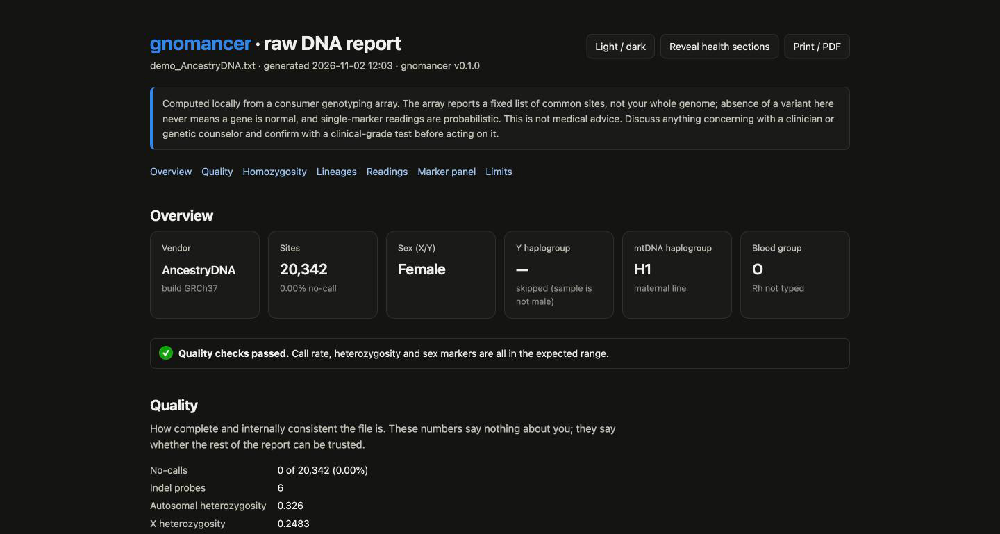

<h1 align="center">
  <br>
  gnomancer
</h1>

<p align="center"><strong>Your DNA, decoded on your own machine.</strong><br>
<a href="https://gnomancer.com">gnomancer.com</a> ·
<a href="https://gnomancer.com/get-your-data/">get your raw data</a> ·
<a href="https://gnomancer.com/install/">install</a> ·
<a href="https://pypi.org/project/gnomancer/">PyPI</a> ·
<a href="https://registry.modelcontextprotocol.io">MCP Registry</a></p>

<p align="center">
<a href="https://pypi.org/project/gnomancer/"></a>
<a href="https://github.com/codebase/gnomancer/actions/workflows/ci.yml"></a>
<a href="LICENSE"></a>
</p>

Take the raw file you already downloaded from **AncestryDNA, 23andMe, MyHeritage, FamilyTreeDNA or LivingDNA** and turn it into one readable report. Everything runs on your computer. Nothing is uploaded.

## Quick start

```bash
pipx install gnomancer      # Python 3.10+; Java 11+ for the haplogroup and PharmCAT steps
gnomancer setup             # fetches the open-source tools and reference files once (~250 MB)
gnomancer ~/Downloads/AncestryDNA.zip
```

Open `AncestryDNA_analysis/REPORT.html`. No Python? `curl -fsSL https://gnomancer.com/install.sh | bash` does it all. Windows: [via WSL](https://gnomancer.com/install/).



## What you get

- **Plain language first.** An at-a-glance digest, then a narrative your own AI assistant can write from a prompt the run gives you.
- **Lineages.** Y haplogroup (yhaplo, plus Yleaf on current YFull/FTDNA/ISOGG trees) and mtDNA haplogroup (Haplogrep3), each with population context.
- **Traits and ancestry markers.** About 110 well-replicated sites: pigmentation, lactose, caffeine, bitter taste, blood group and more.
- **Health, carefully.** Carrier sites, common risk variants, a ClinVar scan of every typed site with plausibility scoring, and PharmCAT pharmacogenomics. All collapsed by default so nobody sees a result they didn't ask for.
- **Honest limits.** Every section says what the chip can and cannot tell you.

## Use it from your AI assistant

gnomancer is also an MCP server. Connect it and ask "what does my report say about caffeine?"

```bash
claude mcp add gnomancer -- uvx gnomancer serve          # Claude Code; Claude Desktop/Cursor: command "uvx", args ["gnomancer","serve"]
```

Only derived results reach the assistant, never the raw file. Health tables are separate tools fetched only on request. The repo also works as a Claude plugin (`skills/gnomancer/SKILL.md`).

## Privacy

Your genotype file never leaves your machine. The only network traffic is the one-time download of public tools and references. The optional `--ai` flag sends the structured results (not the file) to the Anthropic API to write the narrative, and only when you ask.

## Not medical advice

A genotyping array reads about 0.02% of the genome at pre-chosen sites, and its calls at rare sites are wrong often enough that a clinical lab found [40% did not confirm](https://doi.org/10.1038/gim.2018.38). gnomancer tells you what the chip says and how far to trust it. Confirm anything that matters with a clinical-grade test and a clinician or genetic counselor.

## More

[CLI options](docs/cli.md) · [vendors and quirks](docs/vendors.md) · [the marker panel](docs/marker-panel.md) · [tools under the hood](docs/tools.md) · [development](docs/development.md) · [MCP registry](docs/mcp-registry.md) · [contributing](CONTRIBUTING.md)

MIT licensed. The bundled tools keep their own licenses.

<sub>mcp-name: com.gnomancer/gnomancer</sub>
