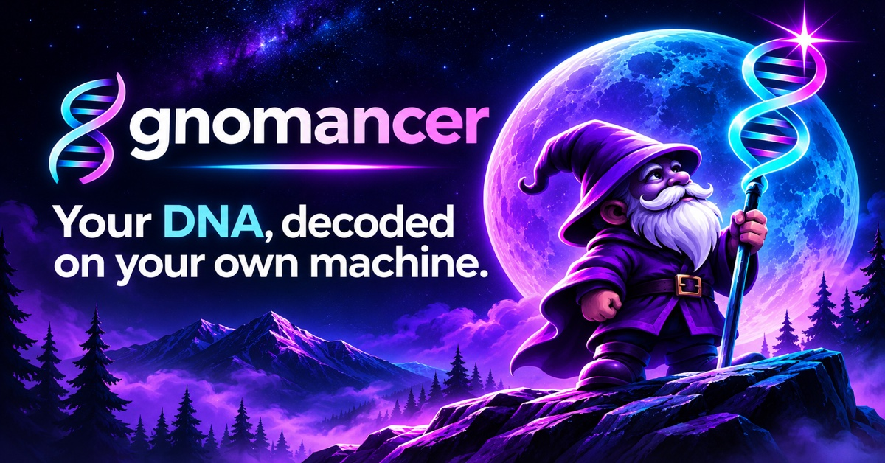

<p align="center"></p>

<p align="center">
<a href="https://gnomancer.com">gnomancer.com</a> ·
<a href="https://gnomancer.com/demo/">synthetic demo</a> ·
<a href="https://gnomancer.com/get-your-data/">get your raw data</a> ·
<a href="https://gnomancer.com/install/">install</a> ·
<a href="https://pypi.org/project/gnomancer/">PyPI</a> ·
<a href="https://registry.modelcontextprotocol.io">MCP Registry</a> ·
<a href="https://discord.gg/aGjqzqErQH">Discord</a></p>

<p align="center">
<a href="https://pypi.org/project/gnomancer/"></a>
<a href="https://github.com/codebase/gnomancer/actions/workflows/ci.yml"></a>
<a href="LICENSE"></a>
</p>

Take the raw file you already downloaded from **AncestryDNA, 23andMe, MyHeritage, FamilyTreeDNA or LivingDNA** (or a VCF) and turn it into one readable report. Everything runs on your computer. Nothing is uploaded.

## Quick start

```bash
pipx install gnomancer      # Python 3.10+; Java 17+ for the mtDNA haplogroup and PharmCAT steps
gnomancer ~/Downloads/AncestryDNA.zip   # first run fetches the open-source tools and references once (~250 MB)
```

Open `AncestryDNA_analysis/REPORT.html`. No Python? `curl -fsSL https://gnomancer.com/install.sh | bash` sets everything up (macOS and Linux; Windows [via WSL](https://gnomancer.com/install/)).


## What you get

- **Plain language first.** An at-a-glance digest, then a narrative your own AI assistant can write from a prompt the run gives you.
- **Lineages.** Y haplogroup (yhaplo, plus Yleaf on current YFull/FTDNA/ISOGG trees) and mtDNA haplogroup (Haplogrep3), each with population context.
- **Traits and ancestry markers.** About 110 well-replicated sites: pigmentation, lactose, caffeine, bitter taste, blood group and more.
- **Health, carefully.** Carrier sites, common risk variants, a ClinVar scan of every typed site with plausibility scoring, and PharmCAT pharmacogenomics. All collapsed by default so nobody sees a result they didn't ask for.
- **Family mode.** `gnomancer family dad.zip mom.zip me.zip` shows shared DNA and the likely relationship for each pair, which lines you share, and which parent each of your alleles came from.
- **Stays current.** `gnomancer watch` re-checks ClinVar each month and tells you only what was reclassified at sites you carry.
- **Honest limits.** Every section says what the chip can and cannot tell you.

## Use it from your AI assistant

gnomancer is also an MCP server. Connect it and ask "what does my report say about caffeine?"

```bash
claude mcp add gnomancer -- uvx gnomancer serve          # Claude Code; Claude Desktop/Cursor: command "uvx", args ["gnomancer","serve"]
```

Only derived results reach the assistant, never the raw file, and the health tables are separate tools fetched only on request. The repo also works as a Claude plugin (`skills/gnomancer/SKILL.md`).

## Privacy

Your genotype file never leaves your machine. The only network traffic is the one-time download of public tools and references. The optional `--ai` flag sends the structured results (not the file) to the Anthropic API to write the narrative, and only when you ask. If you connect an AI assistant through the MCP server, it sees what it asks for: the report's results, and the genotype at any single site it looks up. With a cloud assistant those go to its provider; with a local model they stay on your machine.

## Not medical advice

A genotyping array reads about 0.02% of the genome at pre-chosen sites, and its calls at rare sites are wrong often enough that a clinical lab found [40% did not confirm](https://doi.org/10.1038/gim.2018.38). gnomancer tells you what the chip says and how far to trust it. Confirm anything that matters with a clinical-grade test and a clinician or genetic counselor.

## More

[Discord community](https://discord.gg/aGjqzqErQH) · [CLI options](docs/cli.md) · [vendors and quirks](docs/vendors.md) · [the marker panel](docs/marker-panel.md) · [tools under the hood](docs/tools.md) · [development](docs/development.md) · [MCP registry](docs/mcp-registry.md) · [contributing](CONTRIBUTING.md)

MIT licensed. The tools it downloads keep their own licenses; see [NOTICE.md](NOTICE.md) for credits.

<sub>mcp-name: com.gnomancer/gnomancer</sub>
